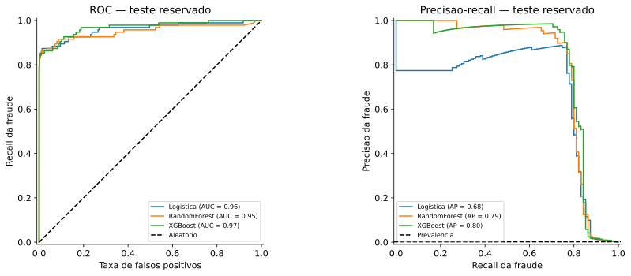
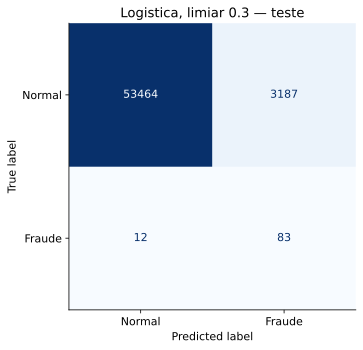
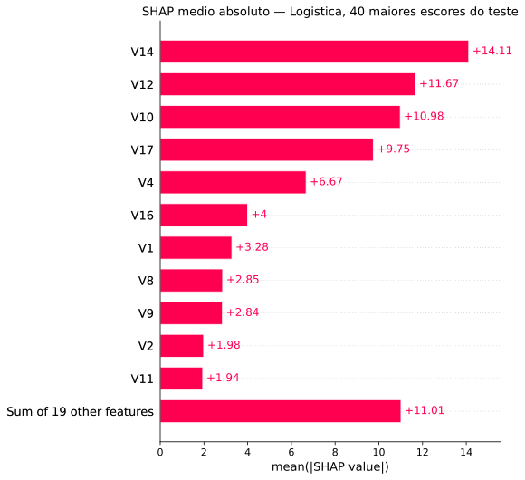
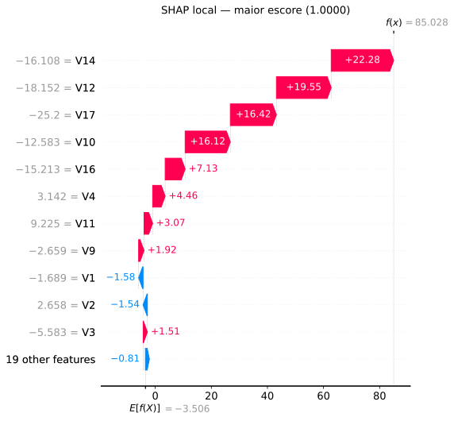

# Detecção de fraude em transações com Python

Projeto educacional da Formação Python for Data Analytics (DIO), implementado com assistência de IA para Felipe. Código original; nenhuma alegação de realização pessoal sem assistência. Não é um sistema aprovado para decisões financeiras reais.

[Notebook executado](deteccao-fraude.ipynb) · [Métricas completas](resultados/metricas.json) · [Validação](validacao.md) · [Requisitos observados](requisitos.md)

## Problema e dados

A base pública indicada pela DIO tem 284.807 transações, 492 fraudes (0,17275%). Um baseline que sempre prevê normal pode ultrapassar 99% de acurácia com recall zero da fraude. Por isso comparamos recall, precisão e F1 da classe positiva, além de average precision e ROC AUC.

Origem: https://storage.googleapis.com/download.tensorflow.org/data/creditcard.csv . O CSV é lido desse link no primeiro uso e mantido somente em cache local ignorado pelo Git. Não é distribuído no repositório. Dataset público anonimizado, sem dados de clientes MeuDiretor. V1–V28 são componentes PCA; não lhes atribuímos significados de negócio.

Foram removidas 1.081 duplicatas exatas antes dos splits. Restaram 283.726 linhas: 170.235 treino, 56.745 validação e 56.746 teste. Split estratificado com semente 42. O teste tem 95 fraudes. Log1p do valor e StandardScaler estão dentro de Pipeline, ajustados no treino e dentro de cada fold da busca.

## Comparação e limiar

Regressão logística e Random Forest usam pesos balanceados; XGBoost usa scale_pos_weight calculado só no treino. GridSearchCV testa C=0,1/1 da logística, três folds estratificados e scoring recall. Os três modelos são comparados na validação nos limiares 0,5 e 0,3; escolhemos por maior recall, desempatando por precisão. Nenhuma reescolha usa o teste.

Resultados **no teste reservado**, após congelar a escolha:

| Modelo | Limiar | Recall fraude | Precisão fraude | F1 fraude |
|---|---:|---:|---:|---:|
| Logística | 0,5 | 87,37% | 4,99% | 0,0945 |
| Logística | 0,3 | 87,37% | 2,54% | 0,0493 |
| Random Forest | 0,5 | 76,84% | 84,88% | 0,8066 |
| Random Forest | 0,3 | 80,00% | 66,67% | 0,7273 |
| XGBoost | 0,5 | 80,00% | 67,86% | 0,7343 |
| XGBoost | 0,3 | 83,16% | 51,97% | 0,6397 |

A regra de recall na validação selecionou **logística, limiar 0,3** (recall de validação 91,49%). No teste detectou 83 de 95 fraudes, perdeu 12 e marcou 3.187 transações normais como fraude. **A precisão de 2,54% torna essa escolha inadequada para uso automático real.** A otimização unilateral de recall é uma demonstração do desafio, não recomendação operacional. O limiar 0,3 não melhorou recall no teste frente a 0,5, e elevou falsos positivos; isso é explicitado, sem trocar a seleção depois de observar o teste.





## O que SHAP mostrou

Aplicamos SHAP ao modelo escolhido, nas entradas já transformadas. Na amostra dos **40 maiores escores do teste**, V14, V12, V10, V17 e V4 tiveram maior contribuição absoluta média. Esse recorte é deliberadamente de alto risco e não representa a distribuição de todas as transações. O waterfall local explica a transação de maior escore. Para a regressão logística, a soma das contribuições está na escala de log-odds, não em pontos percentuais de probabilidade. Attribuições não demonstram causa real de fraude.





## Reproduzir

Python 3.14 foi usado na execução conferida. Crie um ambiente isolado:

```powershell
python -m venv .venv
.venv/Scripts/python.exe -m pip install -r requirements.txt
.venv/Scripts/python.exe build_notebook.py --execute
```

No Linux/macOS, use `.venv/bin/python`. Também é possível abrir o notebook e executar todas as células no kernel do ambiente. O primeiro download tem aproximadamente 151 MB. Treinamento usa no máximo dois workers nas operações configuradas. Arquivos em resultados são recriados; nenhum modelo persistido ou serviço é publicado.

## Diferenças e limites

Além do roteiro da Expert, incluímos deduplicação antes da divisão, validação independente, prevenção de vazamento no scaler/CV, baseline explícito e conferência aritmética das métricas pela matriz. Não usamos oversampling; pesos de classe são o tratamento principal de desbalanceamento. Busca de hiperparâmetros é pequena e restrita à logística, com parâmetros dos outros modelos fixos e inspecionáveis.

Uma divisão aleatória não mede deriva temporal nem generalização a instituições ou períodos diferentes. Poucas fraudes tornam as métricas sensíveis ao split; não apresentamos intervalos de confiança ou custos reais. Critérios de precisão mínima, calibração e validação temporal devem ser definidos em nova validação antes de qualquer uso real. Fonte do desafio e dados consultados em 22/11/2026; conclusão de atividade DIO é distinta da validade operacional de um modelo.
